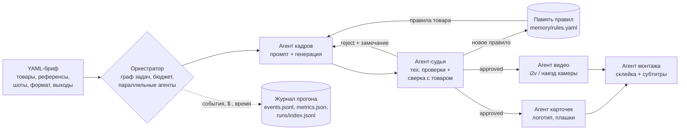

# agent-factory

Агентная фабрика визуального контента: **YAML-бриф → кадры → судья → перегенерация → карточки → видео → монтаж с субтитрами**,
с долговременной памятью правил и журналом метрик каждого прогона.

Собрана из скриптов, которыми я каждый день делаю коммерческий AI-визуал (Seedream / RunningHub / WaveSpeed, Pillow, ffmpeg, Remotion, faster-whisper),
и превращает их из набора ручных шагов в управляемый конвейер с проверкой качества и цифрами.

> Статус: **M1 готов** — весь конвейер работает end-to-end в mock-режиме без единого платного вызова; 11 приёмочных тестов.
> Live-генерация подключена для кадров (RunningHub Seedream 5 Pro) и запускается только с явным потолком трат.

## Архитектура



| Критерий агентной разработки | Где в проекте |
|---|---|
| Spec-driven | Вход — YAML-бриф (`briefs/`), проверяется до запуска (`factory validate`). Сам проект ведётся по спецификациям с критериями приёмки (`specs/`), каждая — тестами |
| Оркестрация нескольких агентов | `factory/orchestrator.py`: граф задач, агенты кадров/судьи/карточек/видео/монтажа, параллельно по шотам (`limits.workers`) |
| Проверка результата | `factory/agents/judge.py`: технические проверки (размер, пустой кадр, разрешение) + сверка атрибутов товара; отбраковка уходит обратно на генерацию с замечанием |
| Память агентов | `factory/memory.py`: каждая отбраковка → правило («гвоздик не должен стать подвеской») с тегом товара и счётчиком; применяется в промптах и чек-листе судьи на следующих прогонах |
| Метрики, прод-кейс с цифрами | `factory/runlog.py`: кадры, доля брака, выход с первой попытки, $, время по агентам; `factory stats` — сводка по всем прогонам |
| Контроль денег | `factory/budget.py`: каждая платная операция резервирует деньги заранее; live только с `--allow-spend`; `factory plan` — вилка стоимости до запуска |
| Ежедневная работа в Claude Code | `CLAUDE.md` (правила для агента), сабагенты `.claude/agents/brief-writer.md` и `judge.md` |

### Агенты

| Агент | Вход → выход | mock (M1) | live |
|---|---|---|---|
| frame | шот + товар + правила памяти + замечания судьи → кадр в формате брифа | сборка кадра из фото товара и референса с вероятностным «дрейфом» атрибутов | RunningHub Seedream 5 Pro (перенос `rh_seedream.py`), WaveSpeed |
| judge | кадр + атрибуты товара → approved / rejected + причины | атрибуты, записанные генератором | M1: человек в терминале; M2: vision-модель |
| card | принятый кадр → карточка с логотипом и плашкой | Pillow, локально (перенос `card.py`) | то же |
| video | принятый кадр → ролик | наезд камеры ffmpeg, локально | M2: MiniMax H3 i2v на RunningHub (перенос `rh_h3.py`) |
| montage | ролики/карточки + подписи → ролик с субтитрами | ffmpeg, фразы по 2–4 слова без висящих предлогов (логика `subs_bs.py`) | M3: Remotion + Whisper, пословная подсветка |

## Быстрый старт (бесплатно)

```bash
python3 -m pip install pyyaml pillow   # нужен ещё ffmpeg для видео и монтажа
python3 examples/make_assets.py        # синтетические фото товаров (уже лежат в репо)
python3 -m factory validate briefs/demo_earrings.yaml
python3 -m factory plan briefs/demo_earrings.yaml
python3 -m factory run briefs/demo_earrings.yaml          # mock по умолчанию
python3 -m factory stats
python3 -m factory memory
python3 -m unittest -v
./scripts/demo.sh                      # всё сразу во временную папку
```

Результат прогона — в `runs/<id>/`: `out/` (кадры всех попыток, карточки, ролики, `montage.mp4`), `events.jsonl` (каждое решение каждого агента),
`metrics.json`, `report.md`.

Live (тратит деньги, только осознанно):

```bash
python3 -m factory plan briefs/my_order.yaml
python3 -m factory run briefs/my_order.yaml --mode live --allow-spend 1.00
```

Ключи — только `RUNNINGHUB_API_KEY` / `~/.config/runninghub/api_key` и `WAVESPEED_API_KEY`; в репозиторий и журналы не попадают.

## Бриф

```yaml
project: demo-earrings
brand: {name: LUMA, tagline: jewelry demo}
format: {width: 720, height: 960}
products:
  - id: stud-pearl
    photos: [../examples/assets/stud_pearl.png]
    tags: [earring-stud, earring]                 # по тегам к товару цепляются правила памяти
    attributes: {earring_type: stud, metal: gold, stone: pearl}   # это проверяет судья
references:
  - {id: warm, path: ../examples/assets/ref_studio_warm.jpg, note: soft warm studio light}
shots:
  - id: s1-pearl-closeup
    product: stud-pearl
    reference: warm
    prompt: close-up portrait in profile, earring in the earlobe
    caption: Жемчуг, который носится каждый день
    card: {title: ЖЕМЧУГ, subtitle: серьги-гвоздики, rows: ['металл: золото 585']}
    video: {motion: slow head turn, seconds: 3}
outputs: {cards: true, videos: true, montage: true}
limits: {max_retries: 2, workers: 3, budget_usd: 1.5}
```

## Цифры

**Сейчас (симуляция, не реальные данные):** `factory bench briefs/demo_earrings.yaml --seeds 20` —
одинаковые сиды, вероятность дрейфа атрибута 30 %, сравнение «каждый прогон с чистой памятью» и «память копится»:

| | брак | с 1-й попытки | кадров на шот | провалов | $ на принятый кадр |
|---|---|---|---|---|---|
| без памяти | 45 % | 50 % | 1,70 | 5 | 0,063 |
| с памятью | 16 % | 84 % | 1,18 | 1 | 0,042 |

Это проверка механики (память действительно снижает брак, бюджет и журнал работают), а не результат на реальных моделях:
в mock эффект правила задан допущением (`IMPROVE` в `factory/backends/mock.py`).
**Цель roadmap — заменить эту таблицу таблицей из live-прогонов на реальных заказах.**

## Roadmap (ноябрь 2026 — январь 2027)

| Этап | Срок | Что | Как проверяется |
|---|---|---|---|
| **M1** ✅ | 31.10 | Конвейер end-to-end в mock: бриф, оркестратор, 5 агентов, судья с перегенерацией, память, бюджет, журнал, `stats`, `bench` | 11 тестов, `specs/m1-mock-pipeline.md` |
| M2 | до 15.11 | Live-кадры на реальном брифе (≤ $1 на прогон, по согласованию); судья — vision-модель со структурным ответом (атрибуты из брифа + правила памяти) и сверкой кропа товара; перенос `rh_h3.py` (i2v) | первый live-прогон в `runs/index.jsonl`; совпадение вердиктов судьи с моими ≥ 90 % на 50 кадрах |
| M3 | до 06.12 | Монтаж через Remotion + faster-whisper: пословная подсветка, правка ослышек, хук-плашка (из `remotion_bs`); QC-агент монтажа по чек-листу (обрывы, стоп-кадры, рассинхрон) | ролик проходит чек-лист без ручных правок |
| M4 | до 31.12 | Ежедневная эксплуатация: каждый заказ и тестовое — через фабрику; Claude Code в цикле (`brief-writer` → `factory run` → `judge`), CI с mock-тестами на GitHub; HTML-дашборд из `runs/index.jsonl` | ≥ 20 live-прогонов, ≥ 300 кадров |
| M5 | январь | Кейс с цифрами: доля брака до/после памяти, $ и минуты на принятый кадр, время брифа против ручного процесса; публикация репо и разбора | статья + таблица из реальных `metrics.json` |

## Структура

```
factory/
  spec.py           бриф → проверенная структура
  orchestrator.py   граф задач, цикл судья→перегенерация, бюджет, метрики
  memory.py         правила из отбраковок
  runlog.py         events.jsonl, metrics.json, report.md, runs/index.jsonl
  budget.py         резерв денег до вызова
  agents/           frame, judge, card, video, montage
  backends/         mock, local (ffmpeg), manual (судья-человек), runninghub, wavespeed
briefs/             брифы
memory/rules.yaml   выученные правила (коммитятся)
config/             цены и выбор бэкендов
specs/              спецификации этапов с критериями приёмки
tests/              приёмочные тесты
.claude/agents/     сабагенты Claude Code
```

## Лицензия

MIT
