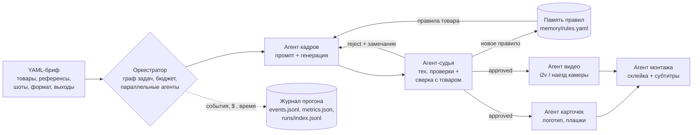

# agent-factory

Агентная фабрика визуального контента: **YAML-бриф → кадры → судья → перегенерация → карточки → видео → монтаж с субтитрами**,
с долговременной памятью правил и журналом метрик каждого прогона.

> **Кейс с цифрами и разбором ошибок — [CASE.md](CASE.md).** Еженедельные отчёты по реальным заказам — [results/weekly/](results/weekly/).

Собрана из скриптов, которыми я каждый день делаю коммерческий AI-визуал (Seedream / RunningHub / WaveSpeed, Pillow, ffmpeg, Remotion, faster-whisper),
и превращает их из набора ручных шагов в управляемый конвейер с проверкой качества и цифрами.

> Статус: **M1 готов**, **M2 в работе** — конвейер работает end-to-end в mock-режиме без платных вызовов;
> судья — Claude (Sonnet) в headless-режиме, точность замерена: 36/36 кадров с известным браком ([results/judge-evals.md](results/judge-evals.md)).
> **Первый live-прогон на реальном товаре:** 4/4 кадра Seedream 5 Pro приняты судьёй, вердикты совпали с ручной проверкой,
> реально списано $0.173 ([results/live-runs.md](results/live-runs.md)). 32 теста.

## Архитектура



| Критерий агентной разработки | Где в проекте |
|---|---|
| Spec-driven | Вход — YAML-бриф (`briefs/`), проверяется до запуска (`factory validate`). Сам проект ведётся по спецификациям с критериями приёмки (`specs/`), каждая — тестами |
| Оркестрация нескольких агентов | `factory/orchestrator.py`: граф задач, агенты кадров/судьи/карточек/видео/монтажа, параллельно по шотам (`limits.workers`) |
| Проверка результата | `factory/agents/judge.py`: технические проверки (размер, пустой кадр, разрешение), сверка атрибутов с фото товара, выполнение сцены шота, цвет камня (ΔE, `factory/color.py`); отбраковка уходит обратно на генерацию с замечанием; `rejudge` перепроверяет старые кадры новым судьёй |
| Память агентов | `factory/memory.py`: каждая отбраковка → правило («гвоздик не должен стать подвеской») с тегом товара и счётчиком; применяется в промптах и чек-листе судьи на следующих прогонах |
| Метрики, прод-кейс с цифрами | `factory/runlog.py`: кадры, доля брака, выход с первой попытки, $, время по агентам; `factory stats` — сводка по всем прогонам |
| Контроль денег | `factory/budget.py`: каждая платная операция резервирует деньги заранее; live только с `--allow-spend`; `factory plan` — вилка стоимости до запуска |
| Ежедневная работа в Claude Code | `CLAUDE.md` (правила для агента), сабагенты `.claude/agents/brief-writer.md` и `judge.md` |

### Агенты

| Агент | Вход → выход | mock (M1) | live |
|---|---|---|---|
| frame | шот + товар + правила памяти + замечания судьи → кадр в формате брифа | кадр рисуется по атрибутам с вероятностным «дрейфом» (гвоздик → подвеска и т. п.); дефект виден на картинке, а не подписан | WaveSpeed Seedream 5.0 Pro Edit (по умолчанию), RunningHub Seedream 5 Pro |
| judge | кадр + фото товара + атрибуты + бриф шота → approved / rejected + причины (атрибуты, сцена, ΔE цвета) | `--judge mock`: истина генератора; `--judge claude`: Claude Sonnet через `claude -p`, JSON-схема | Claude Sonnet или человек в терминале (`--judge manual`) |
| card | принятый кадр → карточка с логотипом и плашкой | Pillow, локально (перенос `card.py`), цвет логотипа по яркости фона | то же |
| video | принятый кадр → ролик → судья по кадрам ролика | наезд камеры ffmpeg, локально | WaveSpeed MiniMax Hailuo 2.3 i2v; MiniMax H3 на RunningHub (перенос `rh_h3.py`) |
| montage | ролики/кадры + подписи → ролик с озвучкой и субтитрами | `engine: ffmpeg` — фразы по 2–4 слова без висящих предлогов (логика `subs_bs.py`) | `engine: remotion` — озвучка Piper с циклом дублей, тайминг слов Whisper, текст из сценария, пословная подсветка, наезд на кадрах |
| qc | готовый ролик → чек-лист монтажа | длительность, звук, чёрные и стоп-кадры, WER «субтитры = звук», синхрон, фразы, склейки, один слой текста | то же |

## Быстрый старт (бесплатно)

```bash
python3 -m pip install pyyaml pillow   # нужен ещё ffmpeg для видео и монтажа
# для монтажа Remotion: pip install faster-whisper, Piper TTS (пути в config/local.yaml), cd remotion && npm install
python3 examples/make_assets.py        # синтетические фото товаров (уже лежат в репо)
python3 -m factory new <папка с фото> --project my-order --task "ТЗ клиента"   # черновик брифа
python3 -m factory validate briefs/demo_earrings.yaml
python3 -m factory plan briefs/demo_earrings.yaml
python3 -m factory run briefs/demo_earrings.yaml          # mock по умолчанию
python3 -m factory stats
python3 -m factory memory
python3 -m factory dashboard                              # runs/dashboard.html
python3 -m factory weekly --since 2026-10-26 --save       # отчёт по live-прогонам → results/weekly/
python3 -m factory run briefs/demo_earrings.yaml --judge claude          # судья — Claude Code (подписка)
python3 -m factory eval-judge briefs/demo_earrings.yaml --judge claude   # замер точности судьи
python3 -m factory rejudge <бриф> runs/<id>                              # перепроверить оплаченные кадры новым судьёй
python3 -m unittest -v
./scripts/demo.sh                      # всё сразу во временную папку
```

Результат прогона — в `runs/<id>/`: `out/` (кадры всех попыток, карточки, ролики, `montage.mp4`), `events.jsonl` (каждое решение каждого агента),
`metrics.json`, `report.md`.

Live (тратит деньги, только осознанно):

```bash
python3 -m factory plan briefs/my_order.yaml
python3 -m factory run briefs/my_order.yaml --mode live --allow-spend 1.00
python3 -m factory run briefs/my_order.yaml --mode live --allow-spend 1.00 --resume runs/<id>   # после сбоя — без повторной оплаты
```

Устойчивость live-режима: id оплаченной задачи сразу пишется на диск, опрос и скачивание повторяются при таймаутах,
сбой одного шота не останавливает прогон, реальные траты меряются по балансу провайдера до/после.

Ключи — только `RUNNINGHUB_API_KEY` / `~/.config/runninghub/api_key` и `WAVESPEED_API_KEY`; в репозиторий и журналы не попадают.

## Бриф

```yaml
project: demo-earrings
brand: {name: LUMA, tagline: jewelry demo}
format: {width: 720, height: 960}
products:
  - id: stud-pearl
    photos: [../examples/assets/stud_pearl.png]
    tags: [earring-stud, earring]                 # по тегам к товару цепляются правила памяти
    color_box: [0.22, 0.39, 0.42, 0.62]           # где камень на photos[0] — эталон цвета
    attributes: {earring_type: stud, metal: gold, stone: pearl}   # это проверяет судья
references:
  - {id: warm, path: ../examples/assets/ref_studio_warm.jpg, note: soft warm studio light}
shots:
  - id: s1-pearl-closeup
    product: stud-pearl
    reference: warm
    prompt: close-up portrait in profile, earring in the earlobe
    caption: Жемчуг, который носится каждый день
    card: {title: ЖЕМЧУГ, subtitle: серьги-гвоздики, rows: ['металл: золото 585']}
    video: {motion: slow head turn, seconds: 3}
outputs: {cards: true, videos: true, montage: true}
limits: {max_retries: 2, workers: 3, budget_usd: 1.5}
judge: {model: sonnet, check_scene: true, max_delta_e: 30}   # + vocab/describe для своих атрибутов
```

## Цифры

### Судья — реальный замер
Кадры с заранее известным браком, судья — Claude через `claude -p` ([подробно](results/judge-evals.md)):

| Судья | Вход | Кадров | Атрибуты верно | Брак пойман | Ложный брак |
|---|---|---|---|---|---|
| Haiku | только кадр | 12 | 70 % | 100 % | 57 % |
| Haiku | кадр + фото товара | 12 | 91 % | 80 % | 29 % |
| **Sonnet** | кадр + фото товара | 36 (2 набора) | **100 %** | **100 %** | **0 %** |
| **Sonnet, реальные кадры** | кадр + фото товара + ΔE цвета + зум | 47 (ручная разметка) | — | **2/2** | 1/45 → 0/45 |

На 47 реальных кадрах коммерческого заказа верный вердикт — **97,9 %** (замер). Ошибки разобраны: мелкие серьги на кадре в полный рост
и рамка камня, попавшая на фон. Отсюда зум по увеличенному фрагменту и **правило двух сигналов**: брак — только когда расхождение
подтверждают оба сигнала, при споре кадр уходит человеку. Пересчёт тех же ответов по этому правилу — 47/47, человеку уходит 2 кадра (4 %);
независимый замер ещё впереди.

Выводы, которые ушли в код: судья всегда получает фото товара. Модель выбирается замером: ложный брак — это лишняя платная перегенерация,
поэтому дешёвый судья обходится дороже.

### Live — реальный товар
Прогон #1 (31.10.2026), серьги-гвоздики, 4 шота: 4/4 кадра приняты с первой попытки, **реально списано $0.173** ($0.043 за кадр).
Ручная проверка нашла то, что судья тогда не проверял: сцена шота не выполнена в 1 кадре из 4. Судье добавлены проверка сцены
и замер цвета камня (ΔE в Lab, откалиброван на 6 настоящих фото товара). `factory rejudge` перепроверил оплаченные кадры
бесплатно: новый судья отбраковал ровно тот кадр, что и человек, а замер цвета опроверг моё впечатление «камень стал оранжевым».
Продолжение (01.11.2026): ролик Hailuo 2.3 из принятого кадра, **реально $0.28**, судья по кадрам ролика 2/2,
монтаж с субтитрами. Весь прогон — **$0.453**. Проверка монтажа нашла субтитр поверх плашки карточки — исправлено.
[Подробно](results/live-runs.md).

### Монтаж — QC-агент
Монтаж live #1 в Remotion из уже оплаченного материала ($0): QC прогнал 6 сборок. Он нашёл латиницу, которую не читает синтезатор,
недетерминированные дубли озвучки и шум распознавания на склеенной речи; глазами найдена фраза через склейку, и эта проверка добавлена в QC.
Итог — QC пройден дважды подряд: WER ≤ 15 %, синхрон 0,04 с, нет стоп- и чёрных кадров. [Подробно](results/live-runs.md).

### Память — симуляция
`factory bench briefs/demo_earrings.yaml --seeds 20`: одинаковые сиды, дрейф атрибута 30 %,
сравнение «каждый прогон с чистой памятью» и «память копится» (результат повторяется точь-в-точь):

| | брак | с 1-й попытки | кадров на шот | провалов | $ на принятый кадр |
|---|---|---|---|---|---|
| без памяти | 43 % | 54 % | 1,65 | 5 | 0,062 |
| с памятью | 15 % | 85 % | 1,16 | 1 | 0,041 |

Это проверка механики, а не результат на реальных моделях: в mock эффект правила задан допущением (`IMPROVE` в `factory/backends/mock.py`).
**Цель roadmap — заменить эту таблицу таблицей из live-прогонов на реальных заказах.**

## Roadmap (ноябрь 2026 — январь 2027)

| Этап | Срок | Что | Как проверяется |
|---|---|---|---|
| **M1** ✅ | 31.10 | Конвейер end-to-end в mock: бриф, оркестратор, 5 агентов, судья с перегенерацией, память, бюджет, журнал, `stats`, `bench` | 11 тестов, `specs/m1-mock-pipeline.md` |
| M2 ✅ | 01.11 | ✅ судья на Claude с JSON-схемой и фото товара, замер точности (`eval-judge`), дашборд, CI-конфиг (`ci/github-tests.yml`), ✅ первый live-прогон ($0.173), `--resume` и устойчивость к сбоям. ✅ проверка сцены и цвета камня, `rejudge`. ✅ замер на 47 реальных кадрах (97,9 %), ✅ зум для мелких серёг и правило двух сигналов, ✅ видео (Hailuo 2.3, H3) и судья видео — **M2 закрыт** | `specs/m2-real-judge.md`; вердикт ≥ 90 % на 30–50 реальных кадрах |
| M3 ✅ | 01.11 | Монтаж через Remotion + faster-whisper: озвучка Piper с циклом дублей, пословная подсветка, правка ослышек по сценарию; QC-агент монтажа (стоп-кадры, чёрные кадры, WER, синхрон, склейки, один слой текста) | монтаж live #1: QC пройден дважды подряд (`specs/m3-montage-remotion.md`) |
| M4 ◐ | до 31.12 | Ежедневная эксплуатация: каждый заказ и тестовое — через фабрику. ✅ `factory new` (черновик брифа из фото и ТЗ), ✅ `factory weekly` (отчёт только по live). Дальше: заказы, независимый замер судьи, CI | ≥ 20 live-прогонов, ≥ 300 кадров, ≥ 5 товаров (`specs/m4-daily-use.md`) |
| M5 | январь | Кейс с цифрами: доля брака до/после памяти, $ и минуты на принятый кадр, время брифа против ручного процесса; публикация репо и разбора | статья + таблица из реальных `metrics.json` |

## Структура

```
factory/
  spec.py           бриф → проверенная структура
  orchestrator.py   граф задач, цикл судья→перегенерация, бюджет, метрики
  memory.py         правила из отбраковок
  runlog.py         events.jsonl, metrics.json, report.md, runs/index.jsonl
  budget.py         резерв денег до вызова
  evals.py          замер судьи на кадрах с известной истиной, rejudge
  color.py          цвет камня: Lab, ΔE76
  dashboard.py      HTML-дашборд прогонов
  new.py            черновик брифа из фото товара и ТЗ (Claude)
  weekly.py         недельный отчёт по live-прогонам
  net.py            сертификаты macOS Keychain для HTTPS (VPN/прокси)
  agents/           frame, judge, card, video, montage, qc
  voice.py          озвучка Piper, тайминг слов Whisper, выравнивание по сценарию, фразы
  backends/         mock + render (кадры с видимым браком), claude_judge, local (ffmpeg), manual, runninghub, wavespeed
briefs/             брифы
memory/rules.yaml   выученные правила (коммитятся)
config/             цены и выбор бэкендов
remotion/           шаблон монтажа (пословная подсветка, наезд на кадрах); npm install один раз
specs/              спецификации этапов с критериями приёмки
results/            замеры (цифры для кейса)
tests/              приёмочные тесты
.claude/agents/     сабагенты Claude Code
```

## Лицензия

MIT
